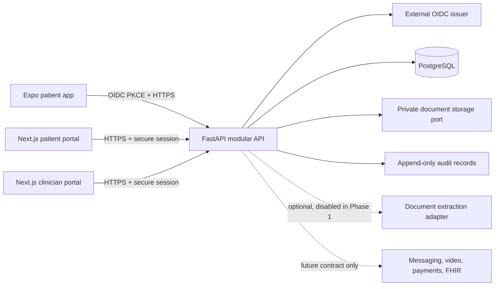
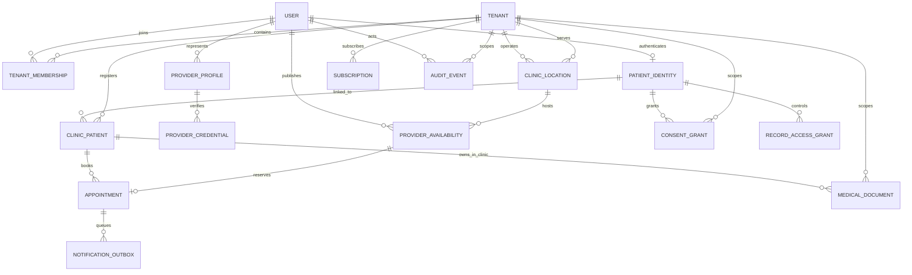

# Healthomatix — target architecture and current implementation

## Architecture decision record

### ADR-001: isolated clinic SaaS platform foundation

- **Status:** Foundation in progress; target decisions remain subject to release gates.
- **Context:** MediGuide is an existing application with uncommitted local
  changes. Its code is useful domain evidence but it is not a safe place to
  build the clinic platform. Healthomatix now has a FastAPI backend, a Next.js
  clinic/patient web preview, an Expo patient shell, an API client, and
  migrations. The web and mobile applications have no sign-in flow, and there
  is no separate SaaS-admin frontend.
- **Decision:** Keep Healthomatix separate and build a modular FastAPI backend,
  PostgreSQL/Alembic persistence, Next.js clinic and patient web portals, a
  React Native/Expo patient app, and a restricted SaaS-admin surface. Use a
  provider-neutral OIDC integration boundary. Do not deploy or connect to
  MediGuide production.
- **Consequences:** Feature code can be reviewed and promoted independently.
  No real sign-in is available until a trusted issuer/client configuration is
  supplied. No production storage provider is enabled in development.
- **Rejected:** Copying the existing monolithic API and web authentication
  flow; using SQLite as the production database; public document URLs; fake
  consultation/prescription endpoints. A real scheduling API is implemented
  behind a default-off environment gate and must only be demonstrated with
  synthetic records until release approvals are complete.

### ADR-002: modular monolith and transaction boundaries

- Keep one deployable API initially, partitioned by domain (`identity`,
  `tenancy`, `patients`, `providers`, `consent`, `documents`, `audit`).
- Domain services own validation and transaction boundaries; repositories
  accept tenant/user scope explicitly. Cross-domain writes are atomic where
  they change authorization, consent, or audit state.
- Keep external capabilities behind ports: identity, document storage,
  extraction, notifications, payment, video, and FHIR.
- Split services only after independent scaling, regulatory boundary, or
  operational ownership requires it.

### ADR-003: tenant and object authorization

- A tenant represents a subscribing organization/clinic boundary. Locations
  belong to a tenant; staff access is granted by active tenant membership.
- A person has one platform identity, but a patient record is not owned by a
  single clinic. Model the patient identity separately from each
  tenant-scoped `ClinicPatient` relationship. A patient may be linked to
  multiple clinics; this does not grant either clinic access to the other's
  records. Cross-clinic sharing requires a separate, explicit, scoped grant.
- Every tenant-owned row carries `tenant_id` (or is reachable only through a
  tenant-scoped relationship with a composite integrity constraint). Every
  request resolves active membership and object-level relationship before
  domain access. Foreign-object access returns a non-disclosing not-found.
- PostgreSQL row-level security is a production hardening requirement before
  regulated-data production use; application-level checks are mandatory even
  when RLS is enabled. RLS context must be established inside each transaction
  from verified server-side membership, including worker and pooled-connection
  paths.

### ADR-004: identity, consent, and audit

- Validate signed OIDC tokens against configured issuer, audience, expiry,
  signing keys, and permitted algorithms. Map `(issuer, subject)` to an
  internal user; never trust client-supplied role or tenant claims for
  authorization.
- Web sessions must use a backend-managed HttpOnly/Secure/SameSite cookie.
  Native uses the system browser with authorization-code + PKCE and secure
  platform token storage. The identity provider remains unconfigured until
  issuer and client IDs are provisioned.
- Consent is a purpose/scope/version-specific grant with append-only grant,
  withdrawal, and expiry history. Provider credential review state is
  distinct from account role.
- Audit events are append-only and payload-minimal. Operational logs exclude
  protected health information and credentials.

### ADR-005: private document storage and AI boundary

- Domain code depends on a `PrivateDocumentStorage` port, never a public URL
  or filesystem path. The current unconfigured adapter fails closed; no
  storage provider or binary transfer route is wired. Any future development
  adapter must be limited to synthetic fixtures.
- Extraction produces draft fields plus page/offset/method provenance. A
  patient or authorized clinician confirms before creating a durable
  clinical-record entry.
- AI is not a clinical decision-maker. No diagnosis, treatment recommendation,
  prescribing, or autonomous triage is enabled in Phase 1.

## Current implementation snapshot

The table below distinguishes implemented foundation from the target
architecture. API implementation details are maintained in
[api-contract.md](./api-contract.md); source presence does not establish
production readiness.

| Area | Implemented foundation | Not implemented / release limitation |
|---|---|---|
| Identity | OIDC bearer-token validation, internal user mapping, tenant membership and role checks. | No configured identity provider, browser OIDC callback/session, or mobile sign-in/PKCE flow. |
| Tenancy and clinic operations | Tenant provisioning, memberships, invitations, locations, patient-clinic links, provider profiles and credential states. | Patient chart/profile model is not yet a full clinic-specific chart design; no multi-location operational workflows or admin UI. |
| Scheduling | Provider availability and appointment booking/cancellation/rescheduling with idempotency, transactional slot handling, audit, and outbox. | Default-off `SCHEDULING_ENABLED`; synthetic demonstration only; outbox has no delivery worker. |
| Documents | Tenant-scoped document metadata and a fail-closed private-storage port. | No upload/download routes, configured storage provider, OCR, extraction, or human verification workflow. |
| Web and mobile | Clinic/patient Next.js previews and a five-destination Expo patient shell. | No authenticated live-data use; these are not production clinical applications. |
| Platform operations | Restricted tenant metadata/provisioning APIs and pending support-access requests. | No subscription billing, usage metering, support-access grant process, or separate admin UI. |
| Clinical workflows | Contracts and domain boundaries only. | Messaging, encounters, notes, telehealth, prescribing, labs/imaging, follow-up, and autonomous AI are not operational. |

Local validation last run for the repository audit: backend tests (29 passed),
API generated-output check, web TypeScript check, and mobile TypeScript check.
These checks do not validate PostgreSQL/RLS, deployment, browser/native
authentication, private storage, vendor integrations, or production controls.

## Proposed target runtime/component view

The diagram is a target design, not a claim that browser/native authentication,
production storage, or future integrations are currently connected.

## Module inventory

| Module | Foundation scope | Later extension |
|---|---|---|
| Identity | OIDC validation/config health, internal user mapping, server-side role checks. | Account recovery, MFA policy, delegated identities. |
| Organization and platform administration | Tenant boundary, clinic locations, memberships, and narrowly scoped provisioning/support administration. | Departments, plans, feature flags, usage metering, enterprise governance. |
| Patient management | Internal user identity, user-keyed minimal profile, and tenant-scoped clinic-patient relationship. | Fully clinic-scoped chart/profile workflows, search, duplicate resolution, dependents, care teams. |
| Provider | Tenant-scoped provider membership/profile and credential-verification state machine. | Specialty directory, availability, licensing-registry integrations. |
| Consent and access grants | Purpose-, scope-, and version-bound grants/withdrawals; explicit cross-clinic access grants. | Encounter-, integration-, and delegated-caregiver consent. |
| Documents and health intelligence | Private document metadata and storage port; no upload/extraction workflow until storage and review gates are implemented. | OCR, page/field provenance, verified lab/imaging summaries, clinician-controlled drafting. |
| Audit | Append-only, privacy-minimal security event trail. | Retention/export and controlled audit review. |
| Scheduling | Tenant-scoped provider availability and appointment booking/cancellation/rescheduling, default-off feature gate, audit and notification outbox; synthetic demonstration only. | Waitlists, delivery workers, external reminders, operational clinical scheduling after review. |
| Telehealth and consultations | Contract only; not enabled. | Participant authorization, waiting room, video-provider adapter, visit lifecycle. |
| Messaging | Contract only; not enabled. | Staff inbox, asynchronous patient-clinician threads, assignment/escalation. |
| Encounters and clinical documentation | Contract only; not enabled. | Clinician-authored notes, sign/lock and amendment lifecycle. |
| Medication and prescribing | Contract only; not enabled. | Medication reconciliation; prescribing only after jurisdictional and clinical review. |
| Labs and imaging | Contract only; not enabled. | External orders/results, terminology, provenance, and reconciliation. |
| Care management | Contract only; not enabled. | Follow-up plans, preventive reminders, chronic-care tasks. |
| Payments and revenue cycle | Contract only; not enabled. | Payment-provider integration, invoices, refunds; later eligibility/claims. |
| Interoperability and remote monitoring | Contract only; not enabled. | FHIR/HL7/EHR exchange and consent-aware device integrations. |
| Operations and governance | Audit foundations only; no unrestricted SaaS support access. | Clinic reporting, retention, access reviews, incident controls. |

## Proposed target entity relationship design

This ERD is a target-domain model, not a diagram of the current SQLAlchemy
schema. The current schema uses `User`/`PatientProfile` for platform identity
and a tenant-scoped `ClinicPatient` link, but does not yet model a separate
`PatientIdentity`, `RecordAccessGrant`, or `Subscription` table. The current
`MedicalDocument` metadata is tenant/user scoped rather than linked to a
`ClinicPatient`. Resolve these differences before expanding chart, sharing,
document, or billing workflows.

### Entity rules

- `User`: internal UUID plus unique OIDC `(issuer, subject)`; no password
  storage in the application.
- `Tenant`: subscribing organization boundary. `ClinicLocation` holds
  location-specific address and timezone; a tenant can operate several
  locations.
- `TenantMembership`: `(tenant_id, user_id, role, status)` with audited
  activation/revocation. Roles are tenant-scoped; provider verification is a
  separate state from membership.
- `PatientIdentity`: globally unique platform-level patient identity, linked
  optionally to a login `User`. Keep minimum demographics here. Do not equate
  identity with a clinic chart or give one clinic access to another's data.
- `ClinicPatient`: tenant-scoped registration/chart relationship, including
  clinic chart number and status. Enforce tenant scope in foreign keys and
  uniqueness constraints. Patient access to a clinic is resolved through
  this relationship and an active patient identity link.
- `ProviderProfile`: professional identity and tenant relationship; store
  only the credential metadata necessary for verification. Treat verification
  references as sensitive; never expose them in patient-facing responses.
- `ConsentGrant` and `RecordAccessGrant`: subject, tenant, purpose, scope,
  policy version, grantor, effective/expiry/withdrawal history. A clinic link
  alone is not authorization to share records across tenants.
- `MedicalDocument`: tenant and clinic-patient relationship, uploader, source
  metadata, retention state, and opaque storage key. Do not place binary
  content or public URLs in the relational row.
- `Subscription`: tenant, plan, status, billing-provider reference, and
  effective periods; payment card data stays with the payment provider.
- `ProviderAvailability` and `Appointment`: tenant-matched provider
  membership, clinic location, clinic-patient relationship, fixed 30-minute
  UTC slot, idempotency key, and single active booking. Patient ownership and
  provider access are checked on every read/write. The API is unavailable
  unless `SCHEDULING_ENABLED=true`.
- `NotificationOutbox`: appointment event type and recipient user IDs only;
  delivery is not configured and events remain pending until a worker/provider
  is separately approved.
- `AuditEvent`: actor, tenant, action, subject type/opaque ID, request ID,
  timestamp; no free-form request body or clinical content.
- All tenant-owned foreign keys and unique constraints include tenant scope
  where appropriate. Object reads require active tenant membership plus
  patient/clinic relationship or an explicit, unexpired sharing grant.

## API conventions

- Prefix: `/api/v1`; JSON over HTTPS; OpenAPI is generated from FastAPI models.
- Authentication: trusted OIDC bearer token for API clients. A server-side
  secure browser session and web OIDC callback are still unimplemented.
  Unconfigured identity returns an explicit service-unavailable/auth-not-
  configured state, not a development bypass.
- Actor classification and access are derived server-side: tenant staff,
  patient portal user, and platform operator are distinct scopes. A platform
  operator does not automatically receive clinical-record access.
- Authorization: derive tenant and role on the server; never accept
  `tenant_id`, patient identity, role, or ownership as authorization proof
  from a request body.
- Errors: stable `{ "error": { "code", "message", "request_id" } }` shape;
  no stack traces or medical payloads.
- Mutations that affect consent, access, credentials, or profile state write
  an audit event in the same database transaction.
- Upload/download APIs are unavailable until a private storage provider is
  configured. Do not return placeholder signed URLs.
- Scheduling endpoints are default-off and are not production clinical-care
  authorization. Do not enable them for real appointments until clinical,
  privacy, security, notification, operations, and legal gates pass.
- Future modules are documentation-only contracts in
  [api-contract.md](./api-contract.md), not mounted endpoints.
